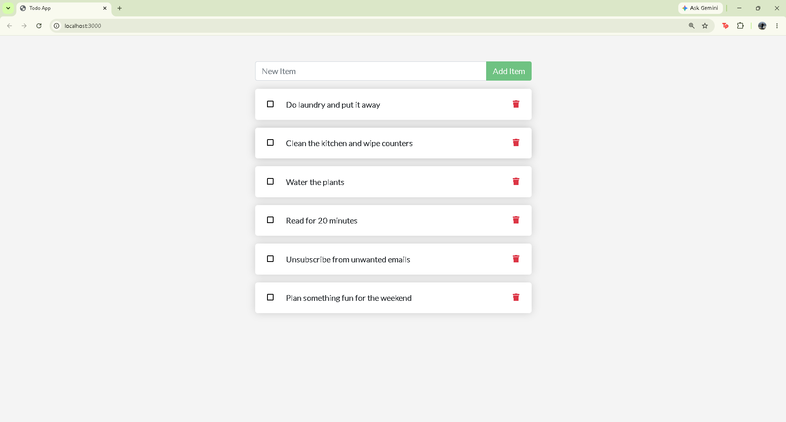
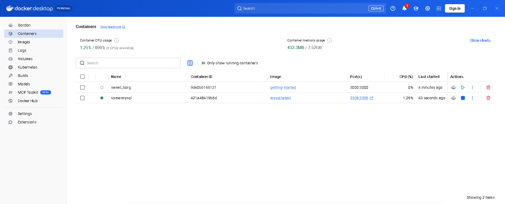
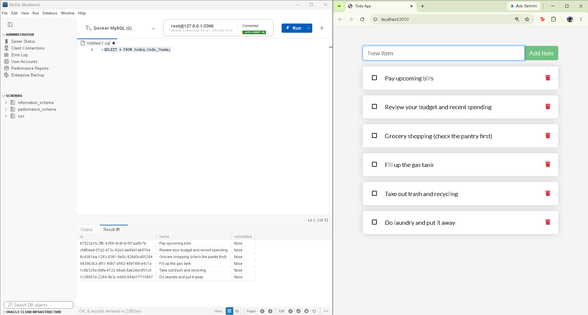

# Lab 6: Containerization with Docker and MySQL

## Overview

This lab introduces containerization and why it is used. A container packages an application together with everything it needs to run (runtime, libraries, dependencies), so it behaves the same on any machine. Unlike a virtual machine, which runs a full guest operating system on top of a hypervisor, a container shares the host's kernel and is much lighter and faster to start.

In this lab I:

1. Installed Docker Desktop (with WSL 2 on Windows)
2. Wrote a Dockerfile, built an image, and ran a containerized Node.js app
3. Ran a MySQL server in a Docker container with port mapping
4. Connected to that server from MySQL Workbench on my host machine
5. Connected the containerized app to MySQL and viewed its data in Workbench

## Repository Structure

```
lab6-docker/
├── README.md
├── screenshots/
│   ├── 01-todo-app.png
│   ├── 02-docker-desktop-running.png
│   └── 03-mysql-workbench.png
└── getting-started-app/
    ├── Dockerfile
    ├── package.json
    └── src/
```

## Part 1: Dockerfile and Image Build

The project is Docker's [getting-started todo app](https://github.com/docker/getting-started-app), following the [Docker Get Started guide](https://docs.docker.com/get-started/02_our_app/).

### Dockerfile

```dockerfile
# syntax=docker/dockerfile:1
FROM node:lts-alpine
WORKDIR /app
COPY . .
RUN npm install --omit=dev
CMD ["node", "src/index.js"]
EXPOSE 3000
```

| Instruction | Purpose |
|---|---|
| `FROM node:lts-alpine` | Base image: Node.js on lightweight Alpine Linux |
| `WORKDIR /app` | Sets the working directory inside the container |
| `COPY . .` | Copies the project files into the image |
| `RUN npm install --omit=dev` | Installs production dependencies |
| `CMD ["node", "src/index.js"]` | Command that starts the app |
| `EXPOSE 3000` | Documents the port the app listens on |

**Note:** The original guide uses `yarn install --production`. The build failed with exit code 127 (command not found) because the current Node image no longer includes Yarn, so I switched to `npm`, which is always included.

### Build and run

```powershell
docker build -t getting-started .
docker run -dp 127.0.0.1:3000:3000 getting-started
```

The `-p 127.0.0.1:3000:3000` flag maps port 3000 on my machine (host) to port 3000 in the container, so the app is reachable at http://localhost:3000.

### Screenshot: app running in the browser



## Part 2: MySQL in Docker

### Commands

```powershell
docker pull mysql
docker run --name some-mysql -e MYSQL_ROOT_PASSWORD=my-secret-pw -p 3306:3306 -d mysql:latest
docker ps
```

| Flag | Meaning |
|---|---|
| `--name some-mysql` | Names the container |
| `-e MYSQL_ROOT_PASSWORD=...` | Sets the root password through an environment variable |
| `-p 3306:3306` | Maps host port 3306 to container port 3306 so tools on my laptop (like Workbench) can reach the database |
| `-d` | Runs the container in the background (detached) |
| `mysql:latest` | The image and tag to run |

### Screenshot: Docker Desktop with running container



## Part 3: MySQL Workbench Connection

Connection settings used in MySQL Workbench:

| Setting | Value |
|---|---|
| Connection Name | Docker MySQL |
| Hostname | 127.0.0.1 |
| Port | 3306 |
| Username | root |
| Password | `my-secret-pw` |

### Connecting the app to MySQL

The todo app uses a local SQLite file by default. It switches to MySQL when `MYSQL_*` environment variables are set. Both containers must share a Docker network so the app can reach the database by container name.

```powershell
# Create a network and attach the MySQL container
docker network create todo-app
docker network connect todo-app some-mysql

# Create the database the app will use
docker exec some-mysql mysql -uroot -pmy-secret-pw -e "CREATE DATABASE IF NOT EXISTS todos;"

# Run the app on the same network, pointed at MySQL
docker run -dp 127.0.0.1:3000:3000 --network todo-app `
  -e MYSQL_HOST=some-mysql `
  -e MYSQL_USER=root `
  -e MYSQL_PASSWORD=my-secret-pw `
  -e MYSQL_DB=todos `
  getting-started
```

After adding todo items in the browser, I queried the data in Workbench:

```sql
SELECT * FROM todos.todo_items;
```

### Screenshot: MySQL Workbench connected and showing data


